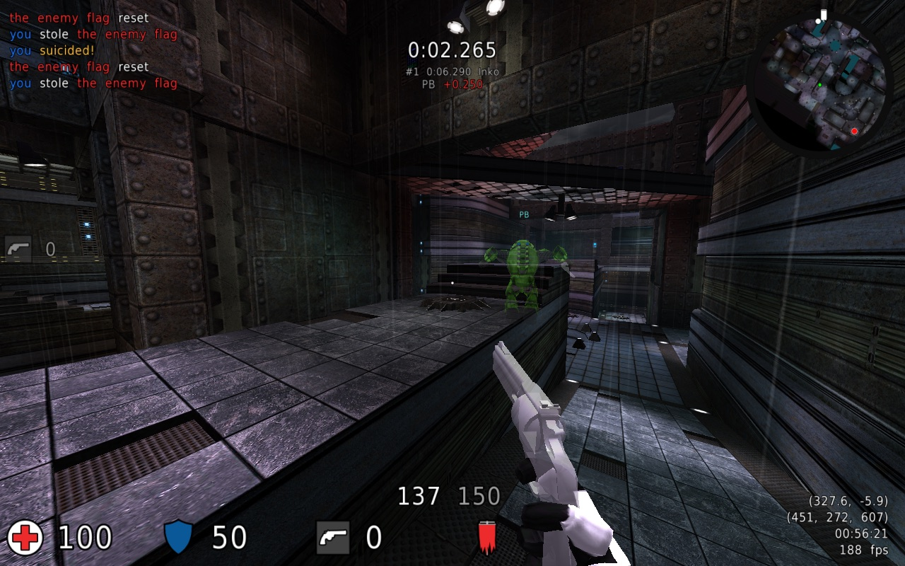
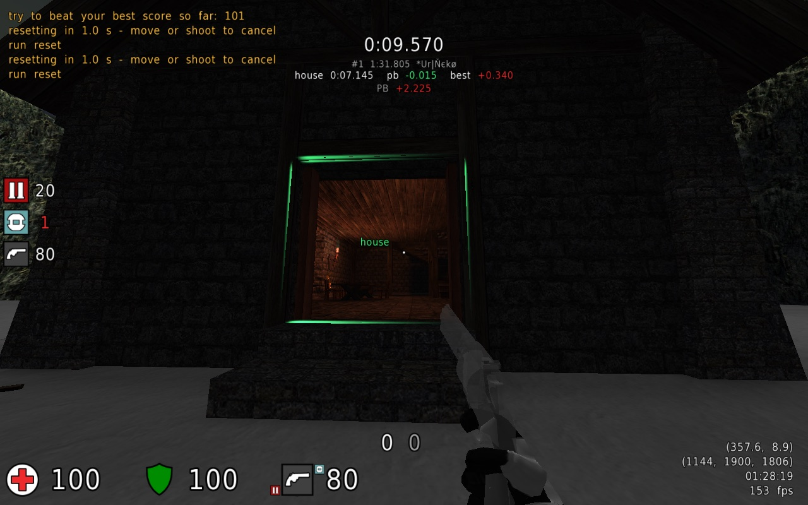
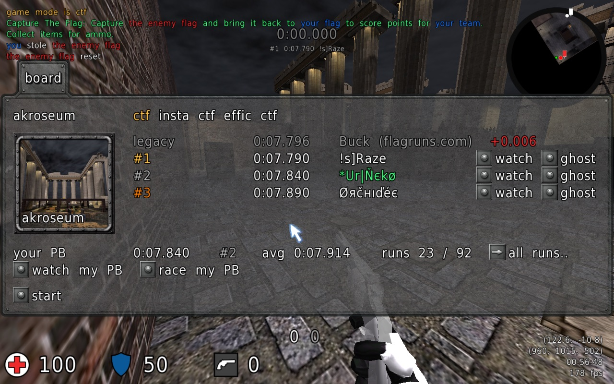
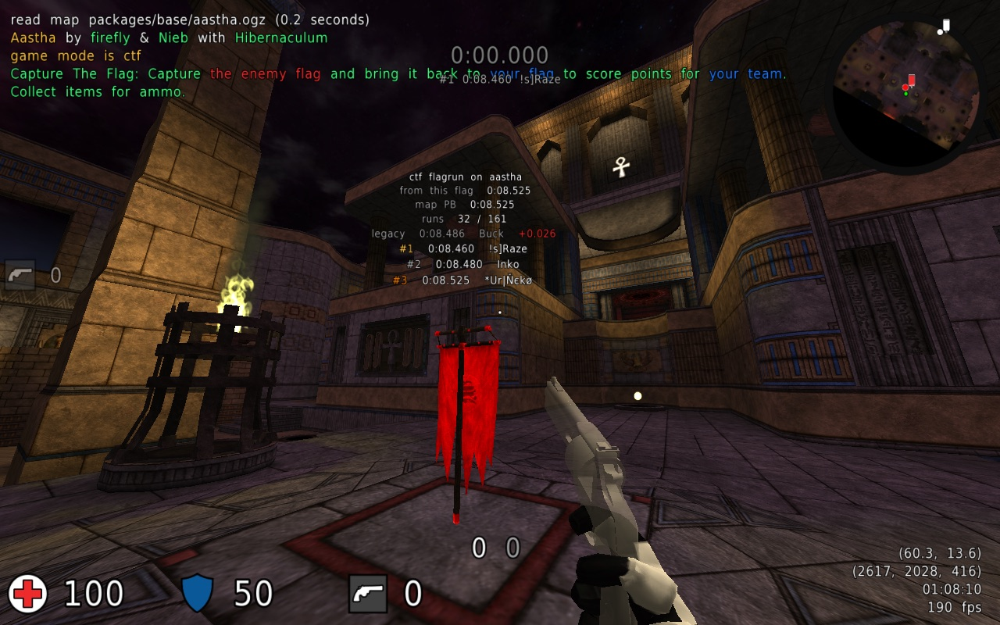
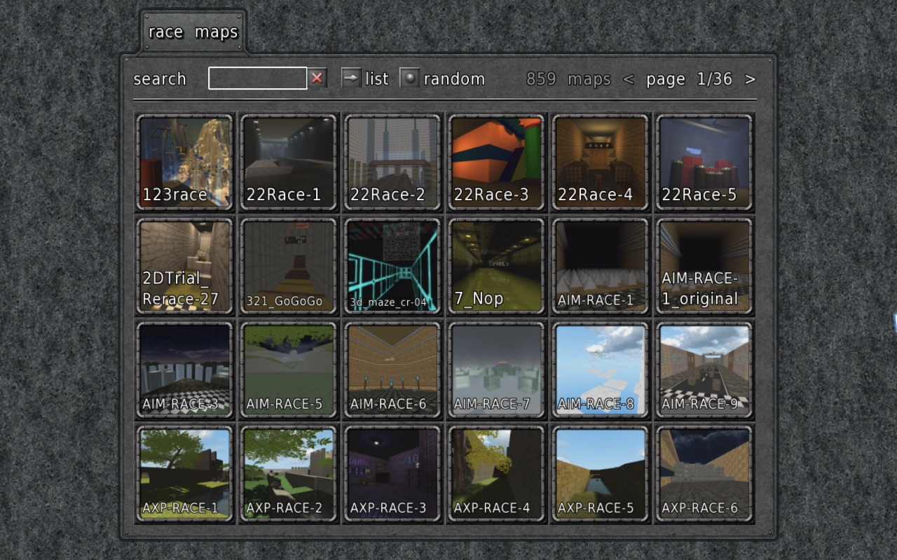
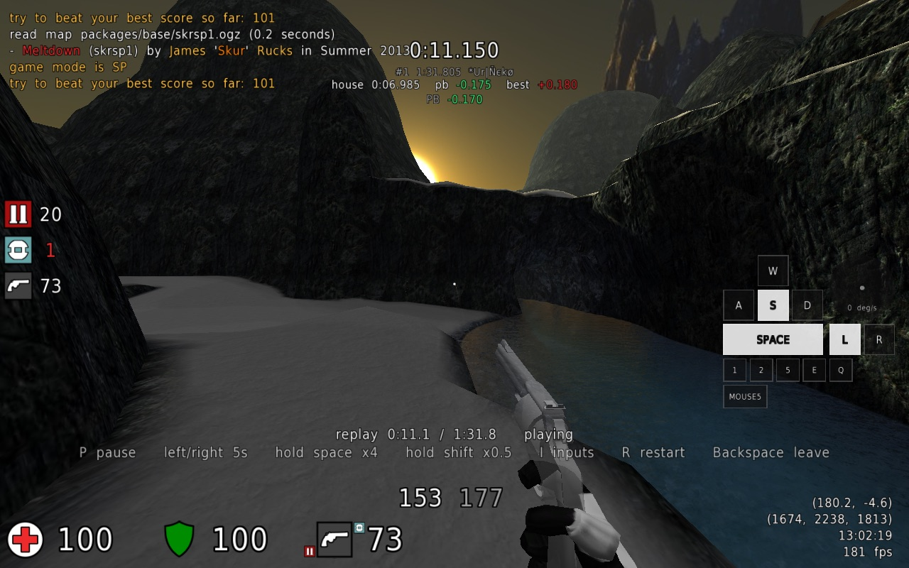
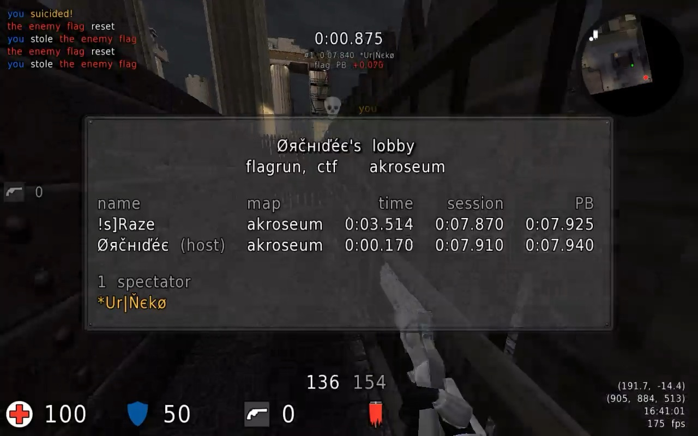
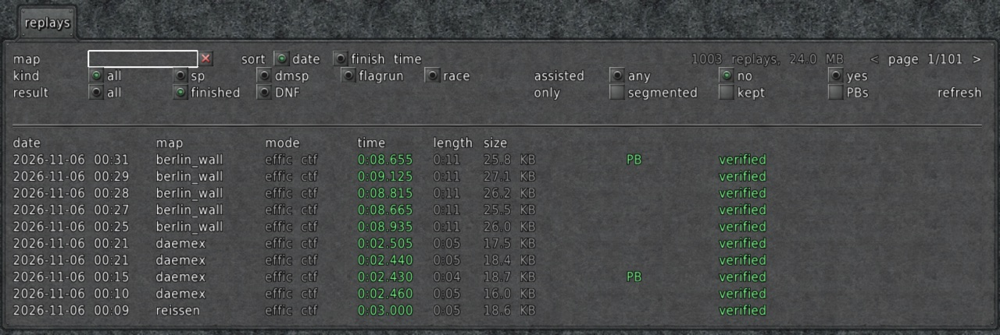

# Speedbraten

A client for speedrunning and flagrunning in Cube 2: Sauerbraten.

Offline games in speedbraten are deterministic: the same map and the same inputs give exactly
the same run, at any frame rate and on every supported system. Runs are timed by the game
simulation, not the wall clock, and every run is recorded as a replay that plays back
identically on any other computer.

## What it does

- **Witnessed runs and leaderboards:** a witness server watches your runs as you play them and
  re-simulates each one, so a time on the leaderboards is a time that was really played. See the
  boards in game with `/board` or on the leaderboard website.
- **Play together online:** the hub shows who is online, with lobbies, chat, lobby players drawn
  as ghosts, and live spectating of other players' runs.
- **PB ghost and splits:** race your best run as a translucent ghost with a live time difference,
  and see every split against your PB and your best segments.
- **Replays of every run:** saved automatically and played back exactly, with a browser to find,
  filter and keep them, and statistics of every run you've played.
- **Practice tools:** save states, step back, instant resets and custom flagrun spawns.
- **Flagruns, races and campaigns:** flagrun and race rules for offline play, browsable map lists
  with pictures, and maps you don't have downloaded from the hub.
- **Your choice of client:** built on p1xbraten, on plain Sauerbraten or on wc-ng.

| | |
|---|---|
|  |  |
| Racing the PB ghost, with the live difference under the timer | A split zone, and the split against your PB and best segment |
|  |  |
| `/board`: the world record, top runs and your place | Above each flag: your best from it, the map PB and the top runs |
|  |  |
| The race map browser | Playing back a replay, with its keys and mouse movement |
|  |  |
| A hub lobby: live run times, session bests and PBs | The replay browser: filters, PBs and witness verdicts |

## Installation

Speedbraten is added to an existing Sauerbraten 2020 installation on Windows (x64), Linux
(x86_64 and ARM64) and macOS 11+ (Apple Silicon and Intel), in three builds: on p1xbraten, on plain
Sauerbraten and on wc-ng. Download it from the
[releases](https://github.com/Darky2020/speedbraten/releases) and follow
[INSTALL.md](INSTALL.md); the game says on launch when a newer release is out.

## Features

Open **speedrun..** in the main menu for the settings. Changes per release are in
[CHANGELOG.md](CHANGELOG.md).

### Timing and rules
- **Run timer** with millisecond precision, timed by the game simulation, for single-player,
  DMSP and multi-map runs. SP runs start when the map loads and end when the map ends.
- **Flagruns** in offline CTF, in three categories:
  - **effic** (effic ctf) and **insta** (insta ctf);
  - **weaponless** (plain ctf): no pickups, no ammo, no attacks.

  The timer starts once you carry the flag out of its base and stops when you score. Flags
  return and players respawn instantly, either flag scores, and there is no capture limit.
- **Race rules** for offline ffa and coop edit:
  - the timer starts at every spawn and stops when you touch any flag;
  - items respawn at once, and your own shots push you without damaging you;
  - entering edit mode voids the attempt.
- **Clean attempts:** with flagrun or race rules, killing yourself also removes your rockets and
  grenades still in flight.

### Practice
- **Save states:** save the whole game state with a key and load it back instantly, with an
  adjustable pause before play resumes. **Step back** rewinds to automatic states taken at a
  set interval.
- **Segmented runs:** load states during a run and finish with one complete run. Its replay
  marks every splice, and segmented runs are kept as their own category.
- **Custom flagrun spawn:** stand still for a second and press a key to spawn there from now
  on. It's saved per map and mode.
- **Fixed race start:** pick one of the map's playerstarts so every race starts in the same
  place. Switching respawns you there at once.
- **Instant reset:** restarting a flagrun or race respawns you without reloading the map.
- **Restart run** and **suicide + respawn** keys, and a speedometer (horizontal or 3D speed,
  optional smoothing).

### Splits and ghosts
- **PB ghost:** a translucent copy of your best run plays alongside you, with a live time
  difference to it. In flagruns it is the best run from the flag you took, and a local flagrun
  starts on your PB's flag. Your segmented PB, or any replay you pick, can be the ghost too.
- **Splits** per map and run kind, in any order, triggered by:
  - entering a zone marked in edit mode;
  - picking up a given item, or using a given teleport;
  - a map-script condition, such as a door opening or a number of monsters killed.

  The HUD shows each split against your PB and against your best time for that segment, the
  sum of best, and your PB difference at the finish. New best segments are highlighted.
  Split files live in `splits/<map>_<kind>.cfg` in your home folder.

### Replays and statistics
- **Replays** of every run, saved automatically. Flagrun and race replays hold just the life of
  the run.
- **Replay browser:** list, filter, sort, rename, keep and play replays.
- **Desync check:** a replay checks the game state while it plays, and says so if it no longer
  matches its recording ("replay desync at tick ...").
- **Statistics** of every run, in `speedbraten.db` in your home folder:
  - per map and mode: PB, average of the last 10 finishes, finished/started count, time played,
    and a separate segmented PB;
  - per map: a list of runs that plays any run's replay.
- **Cleanup rules** pick replays to delete: short or idle runs, runs that never started,
  replays made with an older build, old replays, or all but the fastest N per map. They only
  run when you ask, with a preview before anything is deleted. Kept replays are never touched.

### Online
- **Witness:** runs on the speedbraten witness are streamed to it while you play and checked by
  re-simulating them; witnessed runs go on the leaderboards. The console warns when a run you
  start won't be witnessed, and why.
- **Leaderboards:** `/board <map>` shows a map's world record, top runs and your place per flagrun
  mode or race; the top runs can be watched or raced as ghosts. Equal times share a place.
- **Hub:** who is online, lobbies with a shared scoreboard and finishes, global and lobby chat,
  lobby players as ghosts, spectating, and announcements of new PBs and records. Hub chat and the
  community's Discord channel see each other's messages.
- **Map downloads:** race maps and maps you don't have come from the hub, and maps that changed
  on the hub are downloaded again.

### Map fixes
- **File patches:** speedbraten ships fixed versions of map files (for example missile path's
  script, `crnsp1.cfg`) in `speedbraten_overrides/`. They take priority over your own copies,
  and a replay warns if it was recorded with a different map script.

### Tools
- **sauer_resim:** a headless build (`make resim` in `src/`) that re-simulates a replay without a
  window and prints the result as JSON, for checking runs automatically.

Found a replay that plays back differently? See
[reporting a problem](INSTALL.md#reporting-a-problem-with-a-replay).
